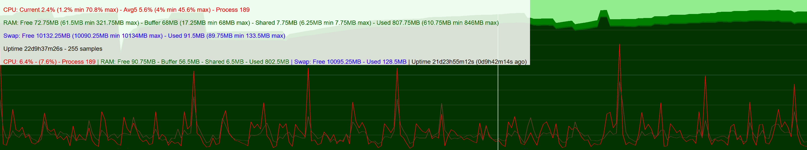

# Record system info

This program records the CPU load, RAM and swap usage in an ring buffer.

To save storage space, each record entry is 16-byte long only. To increase file IO performance, the record file size is memory page and disk cluster aligned (multiple of 4kB). The record file contains a 16-byte header, followed by an array of 16-byte record entries. 

```C
#define FILE_SIZE 4096 // 65536 // Better align with memory page size and disk cluster size
#define DATA_COUNT 255 // 4095 // Cross check with FILE_SIZE, FILE_SIZE = 16 + 16 * DATA_COUNT

typedef struct {
	uint16_t data_wp, data_total;
	uint16_t ram_total, swap_total;
	uint16_t data_blocksize;
	uint16_t _pad[3];
} header_t;

typedef struct {
	uint32_t uptime;
	uint16_t process;
	uint8_t load1, load5;
	uint16_t ram_free, ram_shared, ram_buffer, swap_free;
} data_t;

typedef struct {
	header_t header;
	data_t data[DATA_COUNT];
} buffer_t;
```

# System timer

Use system timer to periodically invoke this program to record system information.

```
systemctl enable --now task.timer
```

# Render the record

The record file content can be rendered as the following graph:
